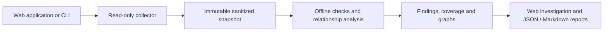

# PEASS'o CSPM

Open-source cloud security posture management for **AWS, Google Cloud, Azure and Kubernetes**, built by HackTricks.

Use the [hosted application](https://cspm.hacktricks.wiki/) to manage workspaces, connect accounts, schedule assessments and investigate findings. Run the native engine locally with `peaso`, or use the provider-specific scripts for detailed IAM/RBAC console and JSON reports.

## What it does

- Collects provider configuration through bounded, read-only adapters.
- Evaluates hardening, exposure, identity, least-privilege and compliance checks against immutable snapshots.
- Presents native evidence, collection coverage, remediation guidance and JSON/Markdown reports.
- Builds network views and declared IAM/privilege-escalation relationships from captured configuration.
- Reviews supported audit events using a pinned public detection-rule pack. A match requires investigation; it does not prove malicious intent.

The running catalog defines supported checks and prerequisites. Framework mappings are review aids, not certifications. Unknown, denied, partial and empty evidence is not proof of compliance. Relationship maps do not establish effective access, exploitability or live network reachability.

## How it works



Collection and evaluation are separate: a saved snapshot can be evaluated again without cloud calls. Reports identify their snapshot and preserve collection gaps. The web application adds authenticated workspaces, connector validation, queued workers, schedules, pagination and report storage. Local storage and hosted AWS services wrap the same engine. In the local container deployment, the analyzer has no network access or connector credentials.

See [local architecture and API](docs/peaso-local.md), [hosted AWS deployment](docs/peaso-aws.md), [the web interface](docs/peaso-ui.md) and [engine contracts](docs/peaso-engine-contract.md).

## Install the CLI

Python 3.10 or newer is required:

```bash
git clone https://github.com/peass-ng/PEASSo-CSPM.git
cd PEASSo-CSPM
python3 -m venv .venv
source .venv/bin/activate
python -m pip install -e '.[cloud]'
peaso --help
```

`peaso`, `hacktricks-cspm` and `python -m peaso` invoke the same native CLI. The historical package and command alias remain available for compatibility.

### Offline demo

```bash
peaso scan --provider aws --demo \
  --snapshot-output /tmp/aws-demo-snapshot.json --output /tmp/aws-demo-report.json
peaso evaluate /tmp/aws-demo-snapshot.json \
  --format markdown --output /tmp/aws-demo-report.md
```

Demo data is synthetic and does not describe a connected account.

### Live configuration checks

Use an existing audit identity with configuration-read permissions for the selected scope:

```bash
# AWS: authenticated SDK profile; account-only scope discovers enabled regions.
peaso scan --provider aws --profile auditor --scopes 111111111111 \
  --snapshot-output /tmp/aws-snapshot.json --output /tmp/aws-report.json

# Google Cloud: existing Application Default Credentials.
peaso scan --provider gcp --scopes audit-project \
  --snapshot-output /tmp/gcp-snapshot.json --output /tmp/gcp-report.json

# Azure: an existing supported local identity.
peaso scan --provider azure --scopes 00000000-0000-0000-0000-000000000000 \
  --snapshot-output /tmp/azure-snapshot.json --output /tmp/azure-report.json

# Kubernetes: existing kubeconfig context.
peaso scan --provider k8s --context audit-cluster --scopes '*' \
  --snapshot-output /tmp/k8s-snapshot.json --output /tmp/k8s-report.json
```

Use private JSON/YAML files with `--auth-file` and `--options-file` for explicit authentication and collection settings, or `--request` for a complete connector request. Local SDK authentication and hosted connector methods differ; consult the provider guides below. Keep credentials and collected reports outside Git.

### Select checks and reuse snapshots

```bash
peaso catalog --output /tmp/catalog.json
peaso scan --provider aws --profile auditor --scopes 111111111111 \
  --categories hardening exposure least_privilege --output /tmp/selected-report.json
peaso collect --provider aws --profile auditor --scopes 111111111111 \
  --output /tmp/snapshot.json
peaso evaluate /tmp/snapshot.json --checks aws.a.iam.attached_policy_no_star_star \
  --output /tmp/iam-policy-check.json
peaso evaluate /tmp/snapshot.json --checks privesc --output /tmp/privesc-report.json
peaso evaluate /tmp/snapshot.json --format markdown --output /tmp/report.md
peaso diff /tmp/report-before.json /tmp/report-after.json --output /tmp/diff.json
```

Use exact identifiers from the catalog with `--categories`, `--checks` and `--frameworks`. Save `--snapshot-output` to retain native evidence for later evaluation; reports normally reference their snapshot rather than embedding it. See [CLI details and report contracts](docs/peaso-engine.md).

## Detailed IAM and RBAC reports

The original scanners report flagged permissions, granting policy/role attribution, principals, memberships, trusts and available usage/key metadata. Their detailed commands and permissions are preserved in the [IAM/RBAC CLI guide](docs/cli-iam.md).

```bash
python Blue-AWSPEAS.py --profile auditor --no-access-analyzer \
  --hardening off --out-json /tmp/aws-iam.json
python Blue-GCPPEAS.py --project audit-project \
  --hardening off --out-json /tmp/gcp-iam.json
python Blue-AzurePEAS.py --subscription 00000000-0000-0000-0000-000000000000 \
  --hardening off --out-json /tmp/azure-iam.json
python Blue-K8sPEAS.py --context audit-cluster \
  --hardening off --out-json /tmp/k8s-rbac.json
```

Pass `--help` to each script for current options. Where supported, `--hardening off` selects the IAM/RBAC audit without native posture checks. Permission severity and complete permission combinations follow the shared [severity policy](docs/permission-severity-policy.md) and [HackTricks categorizations](docs/permission-categorization-sync.md).

## Run the web application locally

With Docker Engine and Compose v2 installed:

```bash
cp .env.example .env
chmod 600 .env
docker compose up --build -d --wait
docker compose exec api cat /var/lib/peaso/identity/local.token
```

Open **http://127.0.0.1:8000** and enter the local token in Settings. API, collector and offline analyzer run separately. Named volumes preserve state and encrypted credentials between restarts; `docker compose down -v` deletes persisted data.

Follow the [local deployment guide](docs/peaso-local.md) for native Python startup, credential mounts, backup/restore and API endpoints, and the [UI guide](docs/peaso-ui.md) for frontend development. Production uses the reviewed GitHub Actions plan/apply workflow described in the [AWS guide](docs/peaso-aws.md).

## Read-only scope

Native collectors do not apply remediation, create resources, enable APIs, generate IAM credential reports or create Access Analyzers. Missing permissions, unavailable services and collection limits remain visible in coverage.

The **legacy AWS IAM script** has optional Access Analyzer provisioning. Pass `--no-access-analyzer` for a strictly read-only audit with that script. Native `peaso` collection does not provision analyzers.

Azure ARM Reader does not grant Graph directory access. GCP requires corresponding API and resource read access. Kubernetes reads selected resource metadata and excludes Secret values, Pod exec/logs and writes. Each provider guide and check describes its evidence requirements.

## Documentation

| Topic | Guide |
| --- | --- |
| Native CLI, reports and checks | [Engine](docs/peaso-engine.md) · [Checks](docs/peaso-checks.md) |
| IAM/RBAC console and JSON CLI | [Provider scripts](docs/cli-iam.md) |
| Local API, workers and storage | [Local deployment](docs/peaso-local.md) |
| Hosted infrastructure and release | [AWS deployment](docs/peaso-aws.md) |
| UI, workspaces and maps | [Web interface](docs/peaso-ui.md) · [IAM/network](docs/peaso-iam-network.md) |
| Provider collection and authentication | [AWS](docs/peaso-aws-collector.md) · [GCP](docs/peaso-gcp-collector.md) · [Azure](docs/peaso-azure-collector.md) · [Kubernetes](docs/peaso-azure-k8s-collectors.md) |
| Passive privilege-escalation analysis | [Catalog and semantics](docs/peaso-privesc.md) |
| Audit-log observations | [Attack analysis](docs/attack-analysis.md) |
| Validation and maintenance | [Validation](docs/peaso-validation.md) · [Permission synchronization](docs/permission-categorization-sync.md) |
| Reproducible compliance inputs | [Compliance ledgers](docs/compliance-ledgers/README.md) |

## License

PEASS'o CSPM is licensed under **GNU AGPL v3 or later**; see [LICENSE](LICENSE). Network operators of modified versions must offer the corresponding source of the running version as required by section 13. The hosted application exposes its source version and corresponding source archive. Third-party dependencies, reference data and assets retain their own licenses and notices.
